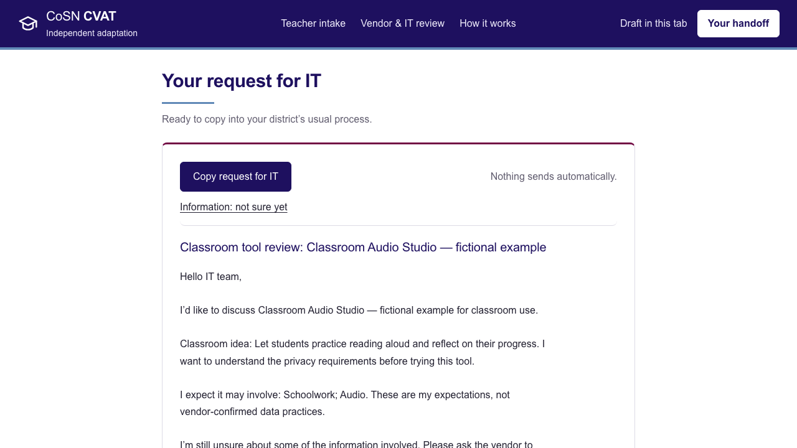
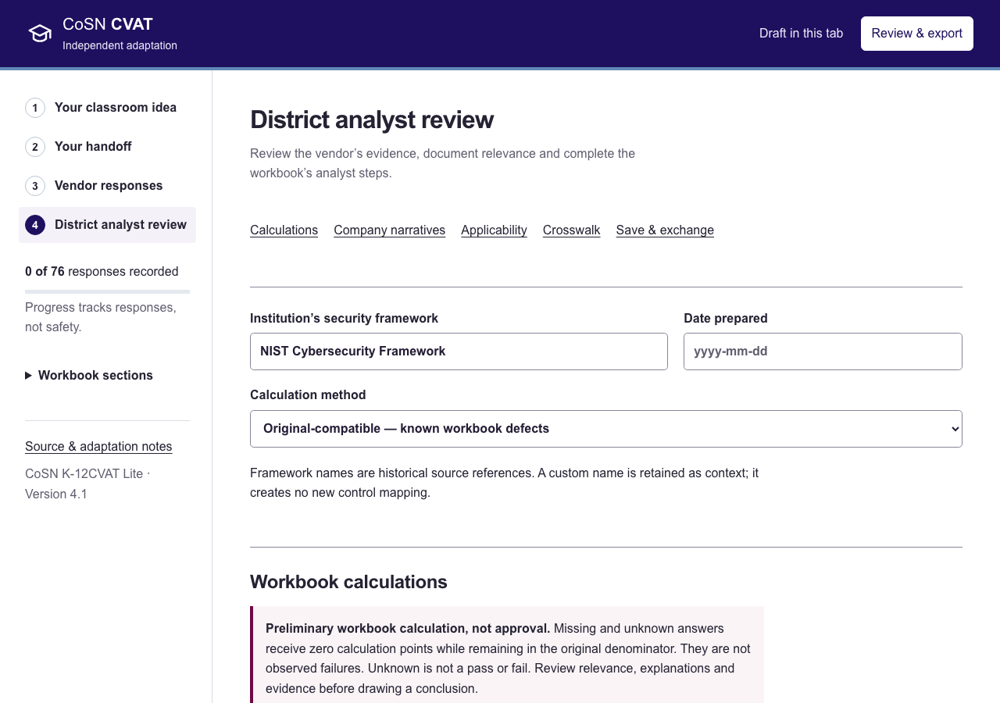
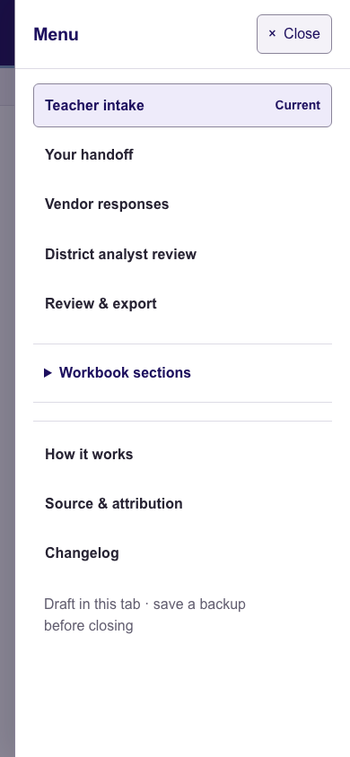

# CoSN CVAT

An independent browser workspace for **CoSN K-12CVAT Lite 4.1**. Teachers prepare a useful request for district IT; vendors and analysts complete the original assessment, review evidence and exchange editable Excel files.

**[Open the application](https://cosn-cvat.daniel-green.chatgpt.site)** · [Run locally](#run-locally) · [Verification](VERIFICATION.md) · [Changelog](CHANGELOG.md) · [License](LICENSE.md)

This is not an official CoSN, EDUCAUSE or MSBA product. It does not certify vendors, establish legal compliance or grant district approval. Teacher expectations never become vendor attestations automatically.



<details>
<summary>See the analyst workspace and mobile navigation</summary>





</details>

Screenshots use fictional classroom context and no student records or asserted vendor controls.

## Use by role

1. **Teacher:** describe the tool, classroom purpose and expected information types. Keep uncertainty explicit. Review the handoff, edit its wording if needed and choose **Copy request for IT**. Nothing is sent automatically.
2. **Vendor:** complete the original questions and provide supporting references. GNRL-01–10 belong to the vendor; GNRL-11–12 belong to institution IT/security.
3. **District analyst:** evaluate answers and evidence, choose the institution's framework, complete the three manual narrative judgments, and review calculations and applicability. Export a record for the district's process.

**How it works** provides optional orientation and a fictional example. **Menu** contains every destination on phones and portrait tablets. The teacher intake is preparation, not a substitute for vendor completion or institutional review.

## Run locally

The app is buildless HTML, CSS and JavaScript. It needs no application account, API key, database, paid service or package installation to run. With Python 3:

```sh
python3 -m http.server 4173 --bind 127.0.0.1 --directory dist
```

Open <http://127.0.0.1:4173>. Use a server rather than opening `index.html` directly: the app fetches bundled data and its workbook template.

Any static host can serve `dist/`; no build command is required. Use HTTPS for browser microphone/clipboard features. Configure your own hosting destination—the original owner's credentials and Sites identity are excluded. Host access controls are separate from this application. **ChatGPT and Sites are optional demo infrastructure, not runtime requirements.** See [standalone hosting and migration](HOSTING.md) for MSBA/district servers, static hosts and backup transfer.

## Assessment coverage and calculation modes

The workspace preserves **76 original fields**: 63 assessment prompts, 12 general-information fields and DATE-01, with original IDs, wording and order. It includes all 59 answer-dependent guidance formulas, analyst reference text, 15 scoring categories, the six historical framework crosswalks and all 662 control descriptions. Added explanations, teacher notes and evidence references are labeled separately.

**Original-compatible** is the default calculation mode. It retains the supplied workbook's arithmetic, favorable answers, denominators and documented defects. Unknown is never converted to No; missing answers can still lower the preliminary source calculation because its denominators remain. Completion, evidence quality and the numeric score are distinct.

**Independent corrections** repairs documented lookup/range omissions and supports reasoned analyst exclusions and favorable-answer interpretations. It is not an official CoSN revision. Neither mode changes recorded vendor answers. Manual COMP-01/02/09 scores contribute to the separate adjusted company value, not the aggregate percentage.

Known source issues include missing COMP-07/08 lookups, HLVU-03's exclusion from the original pivot range, ambiguous favorable Yes for the COMP-05 incident question, broken `#REF!` skip formatting and references to an absent Summary Report. All prompts remain accessible; no skip policy or automatic N/A answer is invented. See **Our version vs. the original** in the app and [source inspection notes](source/WORKBOOK-NOTES.md). Framework references are historical mappings, not current certification claims.

## Save and exchange

| Format | Use |
| --- | --- |
| **JSON — Save/Open a backup** | Complete draft: classroom context, request edits, responses and analyst work. Replacement requires confirmation. |
| **Editable XLSX** | Retains all 12 original tabs and adds labeled review/context/state sheets. Supported answer, manual-review and added context cells can be edited and reimported; conflicting duplicate-view edits are reported. |
| **CSV** | Flat original-field/notes export with formula-injection escaping; not a complete round-trip backup. |
| **Text / print** | Readable teacher request or complete analyst record, depending on the action; not an editable backup. |

Text values accept **32,767 UTF-16 code units**; supplementary characters count as two. Longer imports, pastes and transcripts are rejected without silently truncating existing work. JSON/XLSX input is limited to 64 MiB; expanded XLSX packages to 256 MiB. Macros do not run in the app. Editable input cells must contain values rather than formulas. Exchange supports the supplied Lite 4.1 layout, not arbitrary workbook restructuring.

After editing Excel answers, refresh the original pivot in Excel or reimport/reexport in the app. The added high-risk review sheet is a labeled export snapshot. Hidden app-state sheets contain the draft; hiding is not privacy protection.

## Privacy and dictation

There is no assessment-data backend, cloud sync, analytics or third-party font loading. Responses stay in browser memory unless **Keep a draft on this device** is enabled. That uses local browser storage, not encrypted account storage; clearing browser data can erase it. Export a backup for approved transfer between devices.

Do not enter student personal data, passwords, credentials or confidential security reports. Keep documents in an approved district system and use appropriate references here. A public app/source repository does not publish visitors' local drafts. Exported files do contain entered information: share them through approved channels.

**Dictate** uses feature-detected browser speech recognition, initiated by the user with microphone permission. The browser/provider may process audio remotely; local processing is not guaranteed. The app stores no audio. Stop, review and explicitly append or replace; cancel preserves the field. Unsupported browsers provide typing/native keyboard-dictation guidance. Recognition depends on device, language, policy and network. No paid transcription API is used.

## Source, attribution and license

- [Original CoSN K-12CVAT Lite 4.1 workbook](https://www.cosn.org/wp-content/uploads/2022/11/CoSN-K-12CVAT-Lite-V4.1-2.xlsx)
- [CoSN's official “Using the K-12CVAT” guidance](https://www.cosn.org/wp-content/uploads/2024/03/Using-the-K-12CVAT.pdf)
- Original ChangeLog date: March 1, 2024; retrieved October 21, 2026.
- Unchanged source SHA-256: `1aad4422dc8ba231f4c8ba499311be8a7b8f55ed37081053dd54a535caa94f7d`.

The workbook credits **CoSN's Cybersecurity Advisory Team** for adapting **EDUCAUSE HECVAT-Lite** with permission. The original toolkit was created by the **Higher Education Information Security Council Shared Assessments Working Group**. Its Introduction drawing states **“(C) EDUCAUSE 2019”** and **CC BY-NC-SA 4.0**. Those notices and the untouched workbook are retained.

This adaptation and its added interface/explanations use [CC BY-NC-SA 4.0](https://creativecommons.org/licenses/by-nc-sa/4.0/). Retain credits, source/license links and change notices; preserve noncommercial and share-alike conditions; do not imply endorsement. See [LICENSE.md](LICENSE.md) and the [legal code](https://creativecommons.org/licenses/by-nc-sa/4.0/legalcode.en). Public source does not mean unrestricted commercial use or MIT licensing.

Changes include the browser/teacher workflow, explanations, evidence/unknown states, local drafts, analyst review, separately labeled corrections, dictation and file exchange. Bundled JSZip uses its MIT option; [original notice](dist/vendor/JSZIP-LICENSE.md) and [helper-library notices](dist/vendor/DEPENDENCY-NOTICES.md) are retained separately.

The visual reference was a user-supplied MSBA homepage screenshot, with original education pictograms. No MSBA logo, screenshot or proprietary font is redistributed, and official brand-guide compliance is not claimed. See [design provenance](DESIGN-REFERENCE.md).

## Tests and verified limits

Node.js is required for checks, not for serving the application:

```sh
npm run check
```

Browser suites need [Playwright and a browser](https://playwright.dev/docs/intro) installed in the test environment. From this checkout:

```sh
npm install --no-save --package-lock=false playwright
npx playwright install chromium
```

The mobile, edge-case and several analyst suites also require Google Chrome installed on the machine. Start the local server, then:

```sh
npm run test:browser
npm run test:mobile
npm run test:text-capacity
npm run test:changelog
npm run test:analyst
```

`PLAYWRIGHT_MODULE` can reference an existing installation. Most suites accept `TEST_URL` and `TEST_OUTPUT`; use port 4173 for suites that explicitly target the default. Some use installed Chrome. Native fixture-verification scripts require their documented synthetic inputs; they do not replace an actual Excel session.

The **October 23, 2026 independent audit** passed **20/20 groups—100/100 on its fixed, equally weighted CVAT capability rubric**. Fresh Excel 16.114 recalculation, pivot refresh, save/reopen and actual app import passed across seven synthetic workbooks. All 76 answer cells were checked per file. See [the complete denominator, scenarios and qualifications](VERIFICATION.md) and [audited asset hashes](AUDITED-APP-MANIFEST.json).

This is not universal Excel/browser compatibility or vendor approval. Excel re-encodes the shared CoSN logo during native saving while retaining its picture objects/readable content; bitwise native round-trip identity is not claimed. Real Safari/iPad/phone hardware, screen-reader sessions, actual microphone capture and native print-dialog behavior remain unverified. Desktop viewport simulation and speech mocks do not establish device behavior.

## Maintain and contribute

`dist/` is deployable; `source/` retains the original workbook and provenance; `scripts/` contains extraction and regression checks. `assessment-engine.js` owns calculations, `workbook-exchange.js` handles XLSX, and `model.js`/`limits.js` validate drafts. The native component kit uses semantic tokens; it is not React/shadcn.

Run checks relevant to changes. Preserve exact source IDs/wording, separate explanations, both calculation modes and license notices. Use synthetic test data. Do not commit drafts, assessment exports, credentials, hosting identities, reference screenshots or private audit notes. Contributions must retain this adaptation's attribution and license.
